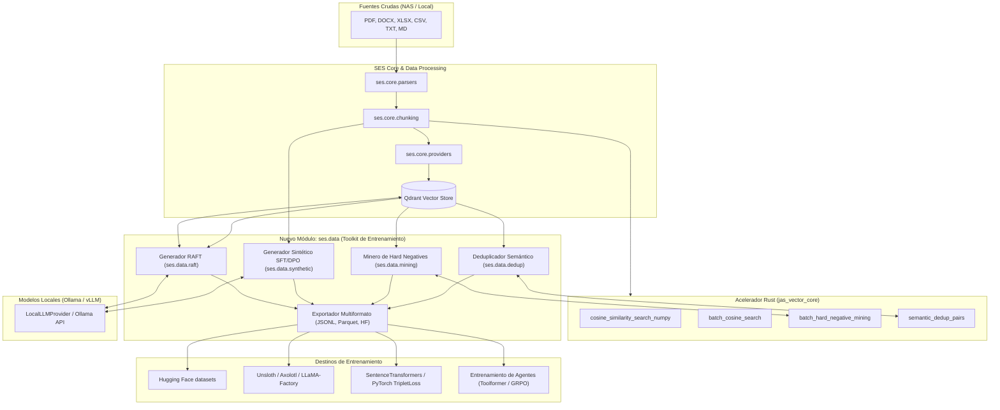

# Plan Integral de Productización: SES como AI Data & Training Toolkit para Modelos de Lenguaje

Este plan técnico detalla la evolución de **SES (Semantic Engine System)** de un motor de búsqueda y RAG documental hacia un **producto integral de infraestructura de datos y curación para el entrenamiento y fine-tuning de modelos de lenguaje (LLMs, SLMs) y modelos de embedding**.

---

## 1. Goal Description

La preparación de datos de alta fidelidad a partir de fuentes documentales privadas es el mayor cuello de botella en el entrenamiento y adaptación de modelos fundacionales. La arquitectura actual de SES posee activos únicos:
1. **Mount Mode y Parsers Multiformato:** Extracción limpia y no invasiva de PDFs, Word, Excel, CSV y recursos SMB sin alterar la fuente.
2. **jas_vector_core (Rust):** Motor de cálculo y re-ordenamiento coseno nativo sobre matrices NumPy contiguas en C, con aceleración en memoria.
3. **Qdrant + Redis:** Capacidad probada de indexación semántica distribuida y control de recencia y frecuencia.
4. **Offline-First & Air-Gapped:** Todo el procesamiento opera localmente sin fuga de propiedad intelectual.

El objetivo de este plan es **productizar SES** para resolver cuatro necesidades críticas en el entrenamiento de LLMs:
- **Minería de Negativos Difíciles (*Hard Negative Mining*):** Aceleración nativa en Rust para tripletas de contraste en modelos de embedding.
- **Deduplicación Semántica (*Semantic Deduplication*):** Barrido de cuasi-duplicados por umbrales de coseno a nivel vectorial para curar corpus de pre-entrenamiento.
- **Generación Sintética Grounded (SFT / DPO):** Síntesis masiva de pares `(instruction, context, response)` y de preferencia `(prompt, chosen, rejected)` con citación documental exacta.
- **Generación de Datasets RAFT (*Retrieval-Augmented Fine-Tuning*):** Creación de ejemplos con Oracle Chunks y Distractor Chunks para entrenar modelos robustos a la alucinación en RAG.
- **Sandbox de Tool-Use / Function Calling:** Entorno interactivo y auditable para entrenar agentes autónomos.

---

## 2. Arquitectura Objetivo del Producto (SES Data & Training Suite)



---

## 3. User Review Required

> [!IMPORTANT]
> **Compatibilidad y Separación de Responsabilidades:**  
> SES actuará como el **motor de generación, curación y estructuración de datasets** (*Data Preparation & Synthetic Engine*), exportando artefactos estándar (`.parquet`, `.jsonl`, `DatasetDict`). **No incorporará dependencias pesadas de entrenamiento** como PyTorch GPU nativo (de 2+ GB) ni CUDA dentro de `ses-core` para no romper la ligereza del motor RAG offline. En su lugar, se añadirá un grupo opcional `pip install "ses-core[training]"` con `pyarrow`, `datasets` y `pandas`.

> [!WARNING]
> **Consumo de Recursos en Generación Sintética Masiva:**  
> La generación de miles de pares SFT/RAFT mediante LLMs locales (Ollama/vLLM) es intensiva en cómputo. Se implementarán colas de trabajo asíncronas con concurrencia limitada (*semáforos*), persistencia de estado de trabajos (*job checkpointing*) y reanudación ante fallos.

---

## 4. Preguntas Abiertas y Decisiones Estratégicas

> [!NOTE]
> 1. **Frameworks de Fine-Tuning preferidos:** ¿Te interesa que los exportadores prioricen formatos específicos como **LLaMA-Factory**, **Unsloth**, **Axolotl** o **ChatML/HuggingFace estándar**?
> 2. **Backend de LLM para la síntesis de datos:** Además de Ollama (actualmente soportado vía HTTP), ¿deseas soporte para endpoints compatibles con OpenAI/vLLM (como vLLM local, LM Studio, TGI o endpoints remotos) en el router de LLM?
> 3. **Exposición en la Interfaz Web:** ¿Deseas que el Portal Next.js incluya una pestaña dedicada ("Training Studio") para lanzar y monitorear la generación de datasets visualmente, o prefieres centrarte primero en la CLI y el Gateway API?

---

## 5. Proposed Changes

Las modificaciones se dividen en 5 componentes ordenados lógicamente:

### Componente 1: Extensión en Rust (`core_rs`)
Optimizaciones en bajo nivel para cálculo vectorial paralelo sobre NumPy arrays C-contiguous.

#### [MODIFY] `core_rs/src/lib.rs`
- Agregar `batch_hard_negative_mining`: recibe una matriz de queries `(N, D)`, matriz de corpus `(M, D)`, los índices positivos conocidos, y retorna los top-$k$ índices con mayor similitud de coseno que no coincidan con los positivos.
- Agregar `semantic_deduplication`: recibe una matriz de documentos `(M, D)` y un umbral $\tau$, retornando pares de índices `(i, j)` cuya similitud supere $\tau$.
- Implementación de paralelismo en bucles de cálculo usando iteradores eficientes.

```rust
// Ejemplo de la nueva función exportada en lib.rs
#[cfg(feature = "python")]
#[pyfunction]
fn batch_hard_negative_mining(
    query_vectors: PyReadonlyArray2<'_, f32>,
    document_vectors: PyReadonlyArray2<'_, f32>,
    positive_indices: Vec<usize>,
    top_k: usize,
) -> PyResult<Vec<Vec<(usize, f32)>>> {
    // Cálculo vectorizado C-contiguous excluyendo positive_indices[q_idx]
    ...
}
```

---

### Componente 2: Módulo de Entrenamiento y Datos (`ses.data`)
Nuevo submódulo Python que orquesta los pipelines de datos.

#### [NEW] `ses/data/__init__.py`
Punto de entrada del submódulo `ses.data`.

#### [NEW] `ses/data/exporters.py`
Funciones utilitarias para validar esquemas y exportar a:
- **JSONL:** Formatos Alpaca (`instruction`, `input`, `output`), ShareGPT (`conversations`), y ChatML.
- **Parquet / Arrow:** Formato de alto rendimiento para ingestión directa en `datasets.Dataset`.
- **DPO / ORPO:** Pares de preferencia (`prompt`, `chosen`, `rejected`).
- **Triplets de Contraste:** `(query, positive, negative_1, negative_2, ...)`.

#### [NEW] `ses/data/mining.py`
- Clase `HardNegativeMiner`:
  - Recibe un corpus de queries y un corpus de pasajes/chunks (ya sea desde memoria o desde colecciones de Qdrant).
  - Utiliza `jas_vector_core.batch_hard_negative_mining` (con fallback transparente en Python/NumPy).
  - Ensambla y exporta datasets listos para entrenar bi-encoders con `SentenceTransformers` (`MultipleNegativesRankingLoss`).

#### [NEW] `ses/data/dedup.py`
- Clase `SemanticDeduplicator`:
  - Permite depurar corpus masivos antes del entrenamiento.
  - Compara fragmentos vectorizados y genera clusters o filtra duplicados que superen un umbral de similitud (ej. $0.90 - 0.98$).

#### [NEW] `ses/data/synthetic.py`
- Clase `SyntheticInstructionGenerator`:
  - Estrategias de síntesis:
    1. **Factual Q&A:** Extrae hechos clave de un chunk y sintetiza preguntas con respuestas verificadas.
    2. **Multi-hop / Contextual:** Cruza dos fragmentos relacionados en el índice vectorial y genera preguntas complejas que requieren razonamiento compuesto.
    3. **DPO Pair Synthesis:** Genera una respuesta de alta calidad fundamentada (*chosen*) y una respuesta plausible pero con alucinación o no fundamentada (*rejected*).
  - Filtros de validación de calidad: consistencia fáctica (NLI) y longitud mínima/máxima.

#### [NEW] `ses/data/raft.py`
- Clase `RAFTDatasetGenerator`:
  - Implementación formal del pipeline RAFT (UC Berkeley):
    1. Para cada documento/chunk objetivo ($D_{oracle}$), genera una pregunta relevante $Q$ y una respuesta fundamentada $A$.
    2. Realiza una búsqueda semántica de $Q$ contra el vector store para obtener $P$ fragmentos distractores ($D_{distractor_1}, \dots, D_{distractor_P}$) que no pertenecen al documento original.
    3. Construye el prompt con contexto mezclado: $Context = Shuffle([D_{oracle}, D_{distractor_1}, \dots])$.
    4. Genera el razonamiento CoT (*Chain-of-Thought*) que enseña al modelo a descartar los distractores y extraer únicamente la información del fragmento verídico.
    5. Exporta el dataset formateado para fine-tuning.

---

### Componente 3: CLI Unificada de Datos (`ses.cli`)

#### [MODIFY] `ses/cli.py`
Añadir el comando `ses data` con los siguientes subcomandos:
- `ses data curate`: Escanea una carpeta y extrae chunks estructurados en formato Parquet/JSONL.
- `ses data dedup`: Ejecuta deduplicación semántica por umbral coseno.
- `ses data mine-negatives`: Genera tripletas `(query, pos, neg)` a partir de un namespace de Qdrant.
- `ses data gen-sft`: Genera un dataset instruccional sintético a partir de documentos indexados.
- `ses data gen-raft`: Genera un dataset RAFT con distractores y citas.

```bash
# Ejemplos de uso previstos:
ses data curate /ruta/documentos --output corpus.jsonl
ses data gen-raft --namespace legal --num-distractors 4 --output raft_legal.jsonl
ses data mine-negatives --namespace contratos --top-k 5 --output triplets.parquet
```

---

### Componente 4: Extensión del Enterprise Gateway (`gateway/`)

#### [MODIFY] `gateway/server.py`
Añadir endpoints para control asíncrono de generación de datasets y especificación de herramientas para agentes:
- `POST /api/v1/datasets/generate`: Inicia un job en segundo plano para generar datasets (SFT, RAFT o Minería de Negativos).
- `GET /api/v1/datasets/jobs/{job_id}`: Consulta el estado, progreso (barra de porcentaje) y logs del job.
- `GET /api/v1/datasets/download/{job_id}`: Descarga el archivo resultante (`.jsonl` o `.parquet`).
- `GET /api/v1/tools/agent-spec`: Entrega la especificación estándar de Tool/Function Calling (formato OpenAI Tools y MCP) para que los frameworks de entrenamiento de agentes puedan conectar SES como herramienta de retrieval.

#### [MODIFY] `gateway/database.py`
- Añadir la tabla `dataset_jobs` en SQLite y PostgreSQL para registrar `job_id`, `tenant_id`, `tipo_job`, `estado`, `total_items`, `items_completados`, `archivo_salida`, `created_at` y `completed_at`.

---

### Componente 5: Portal Web Administrativo (`portal/`)

#### [NEW] `portal/app/studio/page.tsx`
- Interfaz interactiva "Training & Dataset Studio":
  - Selector de namespace de origen.
  - Selección de tipo de dataset (SFT Instruct, DPO Pairs, RAFT con distractores, Minería de Negativos).
  - Parámetros: número de muestras, modelo LLM de síntesis, cantidad de distractores, umbral de similitud.
  - Monitoreo en vivo de trabajos con barra de progreso.
  - Visualizador y previsualizador de muestras generadas con diff de Oracle vs. Distractor.
  - Botón de descarga directa en formato JSONL o Parquet.

#### [MODIFY] `portal/components/Sidebar.tsx`
- Agregar enlace de navegación hacia "Training Studio" con icono de `GraduationCap` o `BrainCircuit`.

---

## 6. Plan de Fases y Cronograma de Ejecución

| Fase | Alcance y Entregables | Duración Estimada |
|---|---|---|
| **Fase 1: Motor Rust & Minería Vectorial** | Funciones `batch_hard_negative_mining` y `semantic_dedup` en `core_rs`, módulo `ses.data.mining` y `ses.data.dedup`, pruebas unitarias en Rust y Python. | Semana 1 |
| **Fase 2: Generador Sintético SFT & RAFT** | Módulos `ses.data.synthetic`, `ses.data.raft` y `ses.data.exporters`, conexión con `LocalLLMProvider` / Ollama, pruebas de generación con mocks y casos reales. | Semana 2 |
| **Fase 3: CLI Unificada & Tool-Use Endpoint** | Subcomandos `ses data ...` en `cli.py`, endpoint de esquemas para agentes `/api/v1/tools/agent-spec`, persistencia de jobs en `database.py`. | Semana 3 |
| **Fase 4: Gateway Jobs API & Portal Studio** | Endpoints de jobs asíncronos en FastAPI, interfaz web en Next.js (`portal/app/studio`), visualizador de datasets y exportación. | Semana 4 |
| **Fase 5: Validación, Benchmarking & Docs** | Benchmark de minería en millones de vectores, pruebas E2E de generación RAFT, tutoriales prácticos de fine-tuning (ej. con Unsloth/HuggingFace) y documentación formal. | Semana 5 |

---

## 7. Verification Plan

### Automated Tests
1. **Pruebas de la Extensión en Rust:**
   ```powershell
   cargo test --manifest-path core_rs/Cargo.toml
   cargo clippy --manifest-path core_rs/Cargo.toml --all-targets -- -D warnings
   ```
2. **Pruebas Unitarias del Toolkit de Datos (Python):**
   ```powershell
   pytest tests/test_data_mining.py tests/test_data_synthetic.py tests/test_data_raft.py -v
   ```
3. **Pruebas de Integración con el Gateway:**
   ```powershell
   pytest tests/test_dataset_endpoints.py -v
   ```
4. **Verificación de Lint y Build del Portal:**
   ```powershell
   npm --prefix portal run lint
   npm --prefix portal run test
   npm --prefix portal run build
   ```

### Manual Verification
1. **Generación CLI de un Dataset RAFT:**
   - Ingestar un lote de 5 documentos en un namespace de prueba:
     `python -m ses.cli mount ./data/sample_docs -n test_raft`
   - Generar 10 ejemplos RAFT:
     `python -m ses.cli data gen-raft -n test_raft --samples 10 -o test_raft.jsonl`
   - Inspeccionar que cada registro contenga: `instruction`, `oracle_context`, `distractor_contexts`, `cot_reasoning` y `answer`.
2. **Minería de Negativos con `jas_vector_core`:**
   - Ejecutar script de benchmark de minería en `tests/performance/benchmark_mining.py` comprobando aceleración sobre NumPy puro (>10x de velocidad).
3. **Validación Visual en Portal:**
   - Abrir `http://localhost:3000/studio`, lanzar un trabajo sintético de 5 muestras, verificar actualización en tiempo real del progreso y descargar el archivo `.jsonl`.
